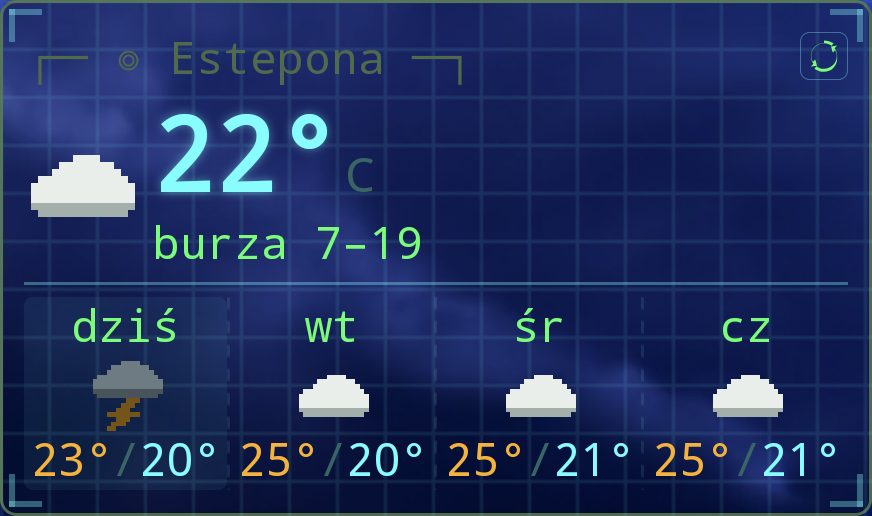

<div align="center">

<br/>

# homebrew&#8209;weather

**The forecast, minus the noise.**

<sub>A pixel-art weather widget for Android that speaks up only when the sky has something to say.</sub>

<br/><br/>



<br/><br/>

[](https://github.com/pi0trdotsys/Homebrew-Weather/releases/latest)
&nbsp;
[](https://github.com/pi0trdotsys/Homebrew-Weather/releases)

</div>

<br/>

```
01  ─  rain, pinned to its day      today up top, other days under their column: ▽ 7–19
02  ─  quiet on quiet days          a dry day is a number and four days, nothing more
03  ─  tap a day, see its hours     the widget opens the app on that day
04  ─  mornings and evenings        a brief at breakfast, tomorrow at dinner
05  ─  rain heads-up, both ends     before it starts, and before a long spell stops
06  ─  fits whatever you give it    any size; a calmer day gets bigger type, not gaps
07  ─  your language, your tone     polski · english  ·  clean · sigma · rude
08  ─  how much, not just whether   "downpour 15–19" or "drizzle", with the millimetres
09  ─  warnings are not jokes       storm, hail, gale, extreme heat: plain and immediate
10  ─  one widget, several places   tap the city name to switch: home, work, anywhere
11  ─  a line for the next 24 hours temperature and rain on one curve (full density)
12  ─  the sun, when it matters     "sunset in 40 min", only in that last hour
13  ─  a tip or a fact, not a joke  well-being tips, or what happened on this day
14  ─  a map of the city behind it  terrain contours, or a skyline on flat land (per widget)
15  ─  rain, to the minute          "rain in about 10 min", from the 15-minute forecast
16  ─  pollen, when it's high       birch, grass...: on the widget and in the brief
17  ─  official warnings (Poland)   IMGW's, beside the ones worked out from the forecast
18  ─  warm to cold, in colour       the temperature runs cyan → amber → red: number, curve, chart
19  ─  day and night on the curve    a night band, and the sun where it rises and sets
20  ─  paper or terminal             light "paper" for a bright wallpaper, or switch with the sun
21  ─  icons, not words              wind, UV, pollen, rain, warnings as tiny pixel glyphs
22  ─  the sky behind the numbers    rain streaks, snow, a flash in a storm, stars at night
```

<br/>

<div align="center">

### Get it

</div>

1. Grab the **APK** from the [latest release](https://github.com/pi0trdotsys/Homebrew-Weather/releases/latest) and open it on your phone.
2. Long-press your home screen → **Widgets** → **Homebrew Weather**.
3. Pick a city and a density (*minimal*, *standard* or *full*). That's it. It refreshes on its own.

Tap the widget to open the full forecast for that city, or tap a day to see its hours.
With several places on a widget, rain and storms are watched for all of them, not just the one on show.
To keep more than one place on a widget, open its setup, switch on *add as another place*
and pick another city; from then on tapping the city name switches between them (the
**≡** next to it opens the setup).
Can't find the widget picker? **./settings** has an *add widget* button that asks your launcher
to pin one. The widget's setup also offers a *Material You* colour theme (Android 12+), a *city map* background
(terrain contours around the city, or a pixel skyline where the land is flat), a *weather*
background (rain, snow, storms and stars drawn behind the numbers, moving only while it
precipitates), an *appearance* choice (dark, light paper, or paper by day and dark at night), and
**./settings** a *high contrast* option for the dim text, in the app and on the widget.
Language, brief and evening times, alert thresholds, tone and what the footer says (a joke, a
well-being tip, or an event from this day in history) are under **./settings**,
along with a button that sends one of each notification so you can see them right away.
It shares only the outdoor temperature with Kropi (the hydration tracker), no location.

> **Updating from beta.11 or earlier?** Uninstall the old version once, then install:
> beta.12 is signed with a new key, and Android won't replace an app signed with a
> different one. From beta.12 onwards, new versions install right over the top and your
> widgets stay put.

<br/>

<div align="center">

<sub>

**private by default**: no account, no ads, no tracking, no server of ours, no cloud backup  
weather straight from [Open-Meteo](https://open-meteo.com/) · location is optional, a city name works too  
polski or english, your pick · still in beta, so rough edges are expected

<br/>

[for developers →](docs/DEVELOPMENT.md)

</sub>

</div>
